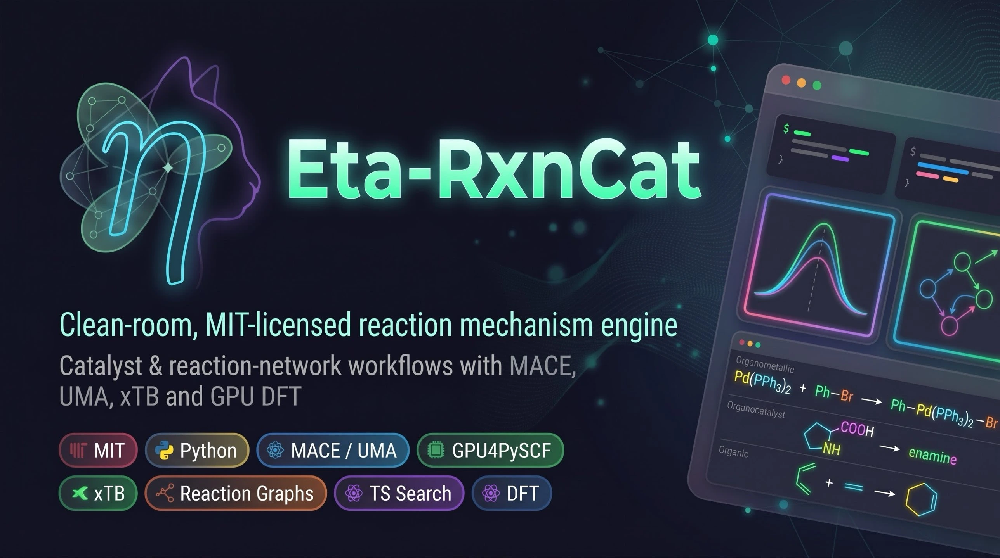

<div align="center">
    
    <h1>Eta-RxnCat</h1>
    <h3><em>Priority-gated reaction-graph workflows for homogeneous catalysis, built on a permissively licensed core.</em></h3>
</div>

<p align="center"></p>

<p align="center">
    <strong>Eta-RxnCat is a computational-chemistry library for mapping organometallic and organocatalytic reaction mechanisms. A reaction is written once as a graph of states and transition states, every molecule carries an explicit charge and spin multiplicity, and each computational stage is cached on its own so a run can resume and extend. Version 0.1.0 lays the foundation: strict data contracts, a validating graph loader, a stage-level artifact store, a GPU hardware probe and a small command line.</strong>
</p>

<p align="center">
    <a href="https://github.com/tjmustard/Eta-RxnCat/releases/latest"></a>
    <a href="https://github.com/tjmustard/Eta-RxnCat/actions/workflows/ci.yml"></a>
    <a href="https://github.com/tjmustard/Eta-RxnCat/stargazers"></a>
    <a href="https://github.com/tjmustard/Eta-RxnCat/blob/main/LICENSE"></a>
</p>

---

## Table of Contents

- [🔬 What is Eta-RxnCat?](#-what-is-eta-rxncat)
- [✨ Features (v0.1.0)](#-features-v010)
- [⚡ Installation](#-installation)
- [🚀 Usage](#-usage)
- [🧪 Development](#-development)
- [🧭 Roadmap](#-roadmap)
- [🙏 Acknowledgements](#-acknowledgements)
- [📄 License](#-license)

## 🔬 What is Eta-RxnCat?

Eta-RxnCat describes a catalytic mechanism as a **reaction graph**. Nodes are reactants,
intermediates, transition states, products and off-cycle sinks. Each node holds one or more ranked
template geometries, and edges are the elementary steps between nodes (catalytic cycles are
allowed). Nodes carry a priority tier, so the most informative steps, such as a
selectivity-determining transition state, can be computed first and used to prune the rest.

The long-term goal, set out in the living master plan, is a workflow that combines force fields,
subprocess-isolated tight binding, machine-learned potentials and DFT (PySCF / GPU4PySCF) under
that priority-gated graph. `v0.1.0` builds the foundation the later engines depend on. Everything
beyond it is listed under [Roadmap](#-roadmap) and is not built yet.

## ✨ Features (v0.1.0)

- **Strict core data contracts** (`eta_rxncat.core`). Pydantic v2 models reject unknown keys and
  are immutable. Charge, spin multiplicity, counts, ranks and atom indices are strict integers
  (`True`, `"1"` and `1.0` are rejected). Every `MolecularState` must have a canonical element
  symbol per atom (Z 1–118), finite N×3 coordinates, and a charge and multiplicity its electron
  count allows.
- **Reaction-graph loader and validator.** `load_reaction_graph` reads YAML or JSON and rejects
  duplicate keys. Every failure is one `GraphValidationError` that names the offending file, key,
  node, template, edge or rule. The graph checks cover unique ids, known edge endpoints, no
  self-loops or duplicate edges, defined pruning-rule references, atom-mapping invariants, and
  equal charge and element composition across a node's templates.
- **Stage cache key and artifact store** (`eta_rxncat.store`). Each stage gets a versioned,
  canonical SHA-256 key built from the geometry (5-decimal grid), the stage settings and the
  engine identity. A WAL-mode SQLite store never silently overwrites a completed artifact:
  `invalidate` is the only way to replace one.
- **Hardware probe and GPU smoke test** (`eta_rxncat.utils.hw_probe`). A typed report of
  PyTorch/CUDA, the GPU, GPU4PySCF and a 6.5 GiB VRAM budget, which never raises for a missing or
  broken package. The smoke test compares GPU4PySCF with CPU PySCF and a CUDA matmul with the CPU
  result, against fixed numeric tolerances. In `v0.1.0` it has been proven on the CPU path; the
  GPU acceptance run has not been recorded yet.
- **Command line**: `eta-rxncat validate` and `eta-rxncat hardware-check [--smoke]`, with a fixed
  exit-code table and one-line errors.
- **Optional extras** `gpu`, `mlip-mace` and `mlip-uma` (declared and locked; no engine uses them
  yet), and a per-environment **licence gate** (`tools/licence_gate.py`).

## ⚡ Installation

Eta-RxnCat uses [`uv`](https://docs.astral.sh/uv/) and supports Python 3.11–3.13 (the lock
targets 3.12).

```bash
git clone https://github.com/tjmustard/Eta-RxnCat.git
cd Eta-RxnCat
uv sync          # core install from the committed uv.lock
uv run pytest    # run the test suite
```

Optional extras, each installed from the lock:

```bash
uv sync --extra gpu                       # PyTorch (CUDA 12.8 wheels), GPU4PySCF, CuPy
uv sync --extra gpu --extra mlip-mace     # adds MACE (mace-torch)
uv sync --extra gpu --extra mlip-uma      # adds UMA (fairchem-core)
```

`mlip-mace` and `mlip-uma` are **mutually exclusive**: they need incompatible `e3nn` versions, so
one environment holds one MLIP at a time, and `uv` refuses to install both.

## 🚀 Usage

Validate a reaction graph:

```console
$ uv run eta-rxncat validate tests/data/reaction_graphs/example_reaction_graph.yaml
OK tests/data/reaction_graphs/example_reaction_graph.yaml
nodes: 3
edges: 2
priority_order: ts_sn2,products,reactants
```

An invalid graph prints one line on stderr and exits 1:

```console
$ printf 'schema_version: 1\nname: empty\nnodes: []\n' > empty.yaml
$ uv run eta-rxncat validate empty.yaml
error: empty.yaml: nodes: List should have at least 1 item after validation, not 0
```

Report the hardware as JSON (exit 0; problems appear in `flags`). On a core install without the
`gpu` extra:

```console
$ uv run eta-rxncat hardware-check
{
  "report_schema": 1,
  "python_version": "3.12.16",
  "platform": "Linux-…",
  "torch": {
    "installed": false,
    "version": null,
    "cuda_available": false,
    "cuda_version": null
  },
  "gpu": null,
  …
  "flags": [
    "torch_missing",
    "cuda_unavailable",
    "gpu4pyscf_missing"
  ],
  …
}
```

Run the GPU smoke test. It exits 0 on a pass, 1 on a failure and 3 when it is skipped because
PyTorch, CUDA or GPU4PySCF is not available:

```console
$ uv run eta-rxncat hardware-check --smoke
{
  "result_schema": 1,
  "status": "skipped",
  "reason": "torch is not installed; gpu4pyscf is not installed",
  "scf": null,
  "torch_op": null,
  …
}
```

| Command | Exit 0 | Exit 1 | Exit 2 | Exit 3 |
|---|---|---|---|---|
| `hardware-check` | report printed | — | usage error | — |
| `hardware-check --smoke` | smoke pass | smoke fail | usage error | skipped |
| `validate <path>` | valid | invalid, unreadable or unsupported file | usage error | — |

`python -m eta_rxncat` is the same command line.

## 🧪 Development

Every change must pass the four gates and the base licence gate:

```bash
uv sync --locked
uv run ruff check .
uv run ruff format --check .
uv run mypy
uv run pytest
UV_PROJECT_ENVIRONMENT=.venv-runtime uv sync --locked --no-dev && .venv-runtime/bin/python -I tools/licence_gate.py --profile base
```

CI also runs the licence gate for each optional extra:

```bash
UV_PROJECT_ENVIRONMENT=.venv-runtime uv sync --locked --no-dev --extra gpu && .venv-runtime/bin/python -I tools/licence_gate.py --profile gpu
UV_PROJECT_ENVIRONMENT=.venv-runtime uv sync --locked --no-dev --extra gpu --extra mlip-mace && .venv-runtime/bin/python -I tools/licence_gate.py --profile mlip-mace
UV_PROJECT_ENVIRONMENT=.venv-runtime uv sync --locked --no-dev --extra gpu --extra mlip-uma && .venv-runtime/bin/python -I tools/licence_gate.py --profile mlip-uma
```

The gate judges every installed package from its exact licence metadata (SPDX expression,
classifiers or licence field), with no substring matching. GPU tests live under `tests/gpu/`
behind the `gpu` marker and are skipped by default. Contributor and agent rules are in
`AGENTS.md`.

## 🧭 Roadmap

### Planned, not yet built

The full plan is `PRDs/Eta-RxnCat_Living_Master_Plan.md`.

- **v0.2.0**: potentials and engines (RDKit force fields, MACE, UMA, PySCF / GPU4PySCF, xtb as a subprocess).
- **v0.3.0**: conformer generation, ground-state optimisation and Boltzmann ensembles.
- **v0.4.0**: the conserved-core structure mapper (a clean-room rewrite of `nMap`).
- **v0.5.0**: transition-state optimisation and an active-core frequency validator.
- **v0.6.0**: selectivity branching and competing transition-state screening.
- **v0.7.0**: combinatorial library enumeration and multi-template fallback.
- **v0.8.0**: the full catalytic-cycle orchestrator and the energetic span model.
- **v0.9.0**: covalent topology audit, summary reporting and an end-to-end fixture harness.
- **v1.0.0**: the production command line, an engine registry and documentation.

## 🙏 Acknowledgements

Eta-RxnCat is a clean-room rewrite inspired by:

- **The conserved-core transition-state model and `nMap`.** Mustard, T. J. L.; Wender, P. A.;
  Cheong, P. H.-Y. *ACS Catal.* **2015**, *5*, 1758–1763. DOI:
  [`10.1021/cs501828e`](https://doi.org/10.1021/cs501828e). The geometry of the bond-forming and
  bond-breaking atoms in catalytic transition states stays nearly invariant across diverse
  catalysts, so new catalysts and substrates can be mapped onto conserved cores.
- **`Eta_Scripts`**, which with `nMap` pioneered Kabsch/quaternion subgraph alignment and ordered
  atom surgery (`keep`, `delete` and `alignment` atom lists).

## 📄 License

The Eta-RxnCat core is released under the MIT licence (see `LICENSE`).

- **MIT core.** The code in this repository, and every package the core install depends on, is
  MIT, BSD or an equivalent permissive licence. Every core dependency must resolve to an SPDX id on
  the allow-list in `pyproject.toml` (`MIT`, `BSD`, `Apache-2.0`, `ISC`, `PSF`, `Zlib`, `CC0-1.0`
  and close variants), with one version-pinned exception, `geometric` 1.1.1 (BSD 3-clause Non-AI).
- **Copyleft only in optional engine extras.** The optional engine extras (`gpu`, `mlip-mace`,
  `mlip-uma`) may pull in NVIDIA CUDA wheels and copyleft or off-list packages, such as `ase`. You
  download these yourself when you install an extra. Each one is a version-pinned, per-extra
  exemption. Engines like these can be replaced by a new engine later, but the core stays
  permissive.
- **Nothing copyleft in the repository.** Eta-RxnCat never vendors, copies or imports copyleft
  code. Tests enforce this.

Copyright (c) 2026 Thomas J. L. Mustard Ph.D.
